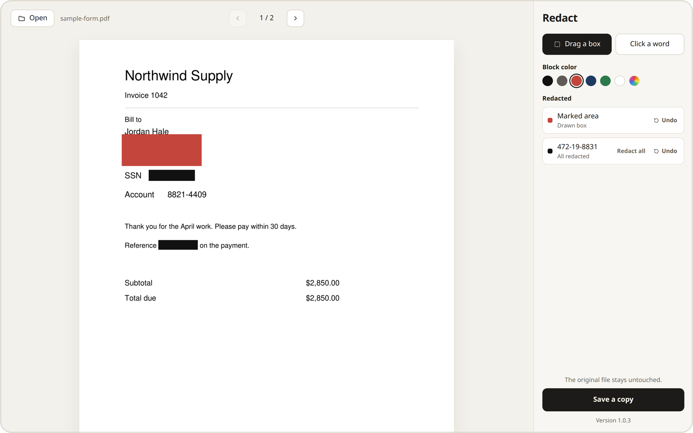
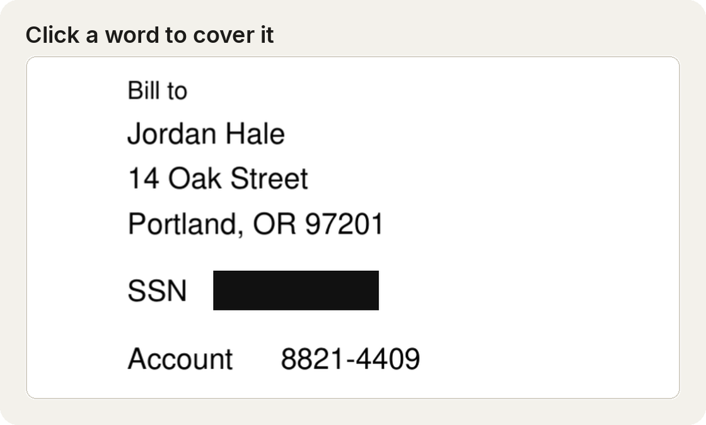
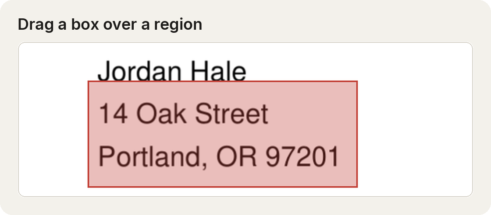
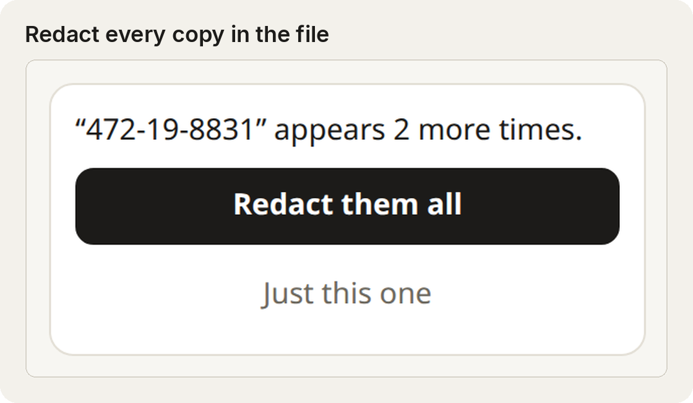
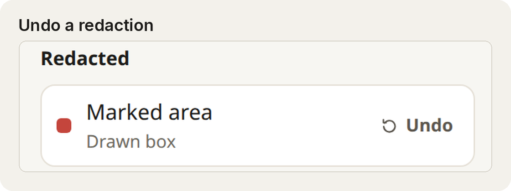
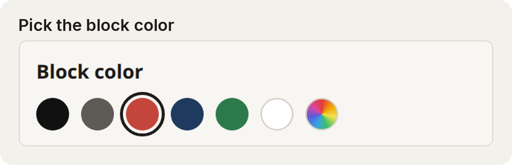
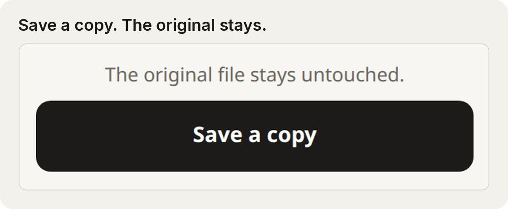

# PDF Redactor

Take information out of a PDF. Click a word or drag a box, pick a color, and save a copy. The original file stays as it is.



A redaction deletes the text underneath it. The word cannot be copied out, searched, or brought back by removing the block. A box also erases the part of a picture it covers, which is how scanned pages are handled.

<p>
  
  
</p>
<p>
  
  
</p>
<p>
  
  
</p>

## Use it

1. Open a PDF, or drop one on the window.
2. **Click a word** redacts that whole word. If the same word appears again, choose **Redact them all**.
3. **Drag a box** covers a region. Use this for a signature, a photo, or a scan.
4. Pick a block color before you redact. Black is the default. White still removes the text.
5. Every redacted string is listed with **Undo** and **Redact all**. Undo takes that string back. Redact all covers every copy still in the file.
6. **Save a copy**. The new file is named with `-redacted` on the end.

Arrow keys turn the page. Ctrl+O opens a file. Ctrl+S saves a copy.

`samples/sample-form.pdf` is a made-up invoice you can practice on. The number `472-19-8831` appears more than once, so you can try **Redact them all**.

Password-protected PDFs are not opened. Text that exists only as part of a picture has no word to click; drag a box over it and that part of the picture is erased.

## Run from source

Python 3.12 or newer:

```bash
python -m venv .venv
source .venv/bin/activate
pip install -r requirements.txt
python -m redactor --browser
```

On Windows, from PowerShell, the activate script is `.venv\Scripts\Activate.ps1`. Install `requirements-windows.txt` as well if you want the app's own window instead of a browser tab:

```powershell
pip install -r requirements.txt -r requirements-windows.txt
python -m redactor
```

The window talks only to your own computer. The PDF is not uploaded.

## Portable Windows app

Build one `.exe` that runs without an installer and without Python:

```powershell
powershell -ExecutionPolicy Bypass -File .\scripts\build_windows.ps1
```

Python 3.12 is needed for that build step. When it finishes, copy `dist\PDFRedactor.exe` anywhere and double-click it.

Each GitHub release also includes that portable file. Download `PDFRedactor.exe` from the release and double-click it. The window and the taskbar show the app icon: three black redaction bars of different lengths.

The portable app uses the WebView2 window that comes with Windows 10 and 11.

## Tests

```bash
pip install -r requirements.txt -r requirements-dev.txt
python -m pytest
```
