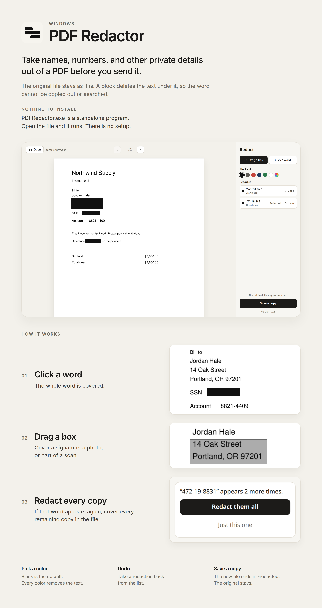

# PDF Redactor

Take information out of a PDF. Click a word or drag a box, pick a color, and save a copy. The original file stays as it is.

A redaction deletes the text underneath it. The word cannot be copied out or searched. A box also erases the part of a picture it covers, which is how scanned pages are handled.

<p align="center">
  
</p>

## Use it

1. Open a PDF, or drop one on the window.
2. **Click a word** covers that whole word. If it appears again, choose **Redact them all**.
3. **Drag a box** covers a region: a signature, a photo, or a scan.
4. Black is the default color. White still removes the text.
5. Each redacted string has **Undo** and **Redact all**.
6. **Save a copy**. The new file name ends in `-redacted`.

Arrow keys turn the page. Ctrl+O opens a file. Ctrl+S saves. Escape closes the “redact every copy” prompt.

Password-protected PDFs are refused. The PDF stays on your computer.

## Download the Windows app

The [one-page site](https://regenerous.github.io/pdf-redactor/) has the Windows and Mac downloads at the top.

`PDFRedactor.exe` is the whole app, about 33 MB. Windows 10 or 11. No installer and no Python.

1. Open [PDFRedactor.exe](https://github.com/regenerous/pdf-redactor/releases/latest/download/PDFRedactor.exe), or the [releases page](https://github.com/regenerous/pdf-redactor/releases) and click **PDFRedactor.exe** under **Assets** on the top release.
2. If Chrome or Edge pauses the download, choose **Keep**, then **Keep anyway**.
3. Open your **Downloads** folder and double-click `PDFRedactor.exe`.
4. If Windows says **Windows protected your PC**, click **More info**, then **Run anyway**.

The window title starts with **PDF Redactor**. Move the file anywhere, including a USB drive, and open it from there.

If the window asks for **WebView2**, install the [x64 Evergreen Standalone Installer](https://developer.microsoft.com/microsoft-edge/webview2/) and open the exe again.

On a Mac with Apple silicon, download [PDFRedactor-mac.zip](https://github.com/regenerous/pdf-redactor/releases/latest/download/PDFRedactor-mac.zip) from the same release. Unzip it and open **PDFRedactor**. The first time, Control-click the app and choose **Open**.

## Build from source

Skip this if you downloaded the exe. The build needs Windows, an internet connection, and Python. It takes a few minutes. The finished exe runs without Python.

### Install Python

1. Open the [Python 3.12.10 page](https://www.python.org/downloads/release/python-31210/) and download **Windows installer (64-bit)** (`python-3.12.10-amd64.exe`). Use the 32-bit installer only if Settings → System → About says **32-bit operating system**.
2. Run the installer. At the bottom of the first screen, check **Add python.exe to PATH**, then click **Install Now**.

### Get the code

1. On the [project page](https://github.com/regenerous/pdf-redactor), click **Code**, then **Download ZIP**.
2. In Downloads, right-click `pdf-redactor-main.zip`, choose **Extract All**, then **Extract**.
3. Open the `pdf-redactor-main` folder (the one that contains `launch.py`, not the zip).
4. Click the address bar, type `powershell`, and press Enter.

Check you are in the right place:

```powershell
dir
```

You should see `launch.py` and `scripts`. Then:

```powershell
python --version
```

You want `Python 3.12.10`. If the Microsoft Store opens, go to Settings → Apps → Advanced app settings → App execution aliases, turn off `python.exe` and `python3.exe`, close PowerShell, and open it again from the folder. If Python is still missing, run the installer again, choose **Modify**, and confirm **Add python.exe to PATH** is checked.

### Build and run

```powershell
powershell -ExecutionPolicy Bypass -File .\scripts\build_windows.ps1
```

Wait until the text stops. A finished build prints a path ending in `dist\PDFRedactor.exe`. Open the `dist` folder and double-click that file. On the blue Windows warning, click **More info**, then **Run anyway**.

`samples\sample-form.pdf` is a practice invoice. The number `472-19-8831` appears more than once.

If the script cannot find Python, fix the PATH step and run it again. If it cannot find the script, PowerShell is in the wrong folder. If `pip` reports a connection error, check the network and run the same command again. If `dist\PDFRedactor.exe` disappears, look in Windows Security → Virus & threat protection → Protection history and allow the file, then build again.

### Run without building an exe

From the extracted folder, one line at a time.

Windows (app window):

```powershell
python -m venv .venv
.\.venv\Scripts\python.exe -m pip install -r requirements.txt -r requirements-windows.txt
.\.venv\Scripts\python.exe -m redactor
```

Use `--browser` instead of the last command to open a browser tab. Press Ctrl+C in PowerShell to stop.

Mac or Linux, after Python 3.12 is installed (macOS installer is on the [same Python page](https://www.python.org/downloads/release/python-31210/); Ubuntu: `sudo apt install python3 python3-venv python3-pip`):

```bash
cd ~/Downloads/pdf-redactor-main
python3 -m venv .venv
./.venv/bin/python -m pip install -r requirements.txt
./.venv/bin/python -m redactor --browser
```

### Tests

Windows:

```powershell
.\.venv\Scripts\python.exe -m pip install -r requirements-dev.txt
.\.venv\Scripts\python.exe -m pytest
```

Mac or Linux:

```bash
./.venv/bin/python -m pip install -r requirements-dev.txt
./.venv/bin/python -m pytest
```

The last line includes `passed`.
